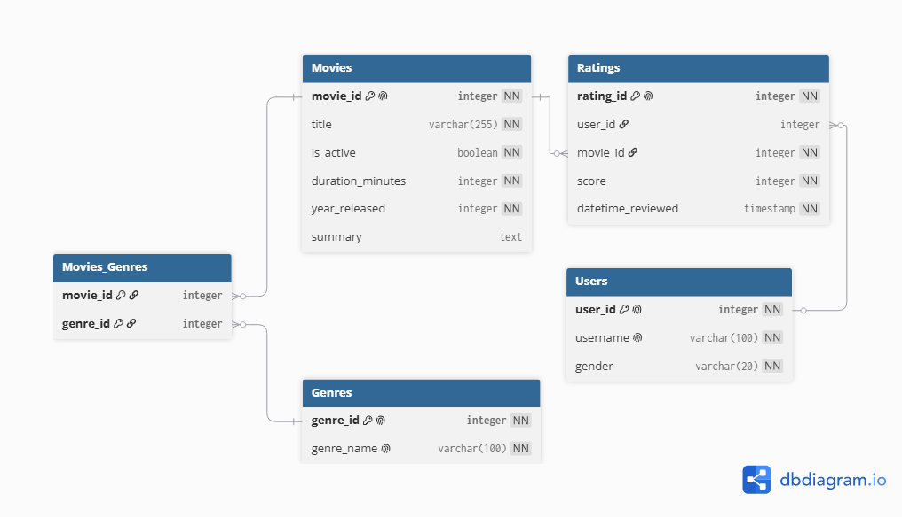

# Movie Rating Database
Theme: Movies

Summary: The purpose of this database is to organize movie and user rating information for analysis purposes. 

The database stores movies, users, ratings, and genres information. Users submit ratings for movies. Each rating records the user, movie, and score data. Movies connect to genres through the junction table movie_genre so that each movie can be associated with multiple genres and each genre can have many movies associated with it. This allows the database to keep the rating and movie data organized. 

The database should be able to answer questions such as which movie has the highest average rating score, how many ratings each movie receives, and how many movies are released each year. This database can also be used to determine whether there is a relationship between a user’s gender and the genres of the movies they rated, and whether longer movies tend to receive higher or lower scores. These questions help analyze movie preferences and understand patterns in movie ratings. 

### Entity Relationship Diagram (ERD)


### Schema

Tables
- users: registered users that are rating the movies
- movies: includes movie information, such as title, release year, and duration in minutes
- genres: includes categories for movie genres, such as comedy, action, etc
- ratings: includes rating information users submit for any movies
- movies_genres: junction table mapping movies to genres (M:N)

Design Decisions
- Created a junction table called movies_genres with a composite primary key to prevent duplicate genres tied to a movie
- Implemented CHECK constraints on attributes like year released, rating score, and gender to ensure only valid data is allowed into the database
- Chose ON DELETE actions such as SET NULL and RESTRICT that best fit the needs and purpose of this database to ensure any essential data that may be used for analysis are not deleted
- Chose the types that fit each attribute such as NUMERIC(3,2) for rating score and varchar(n) with an n that makes sense 
- Added a derived attribute in Movies called display_title which combines the title and year released
- Added a recursive foreign key in movies by adding a foreign key called related_movie_id. This can be used to indicate whether the movie has any related movies, e.g. a prequel or sequel.
- Included a weak entity in Ratings which uses ON DELETE CASCADE and a composite primary key of user_id and movie_id. This also means that a user can only make one rating for a movie.


### Unit 4 Queries

1. What are the count, total, average, minimum, and maximum of the rating scores, and how many distinct users are there?
```sql
SELECT
    COUNT(*) AS count,
    SUM(score) AS total,
    AVG(score) AS average,
    MIN(score) AS minimum,
    MAX(score) AS maximum,
    COUNT(DISTINCT user_id) AS distinct_users
FROM ratings;
```

2. What is the rating count and average score for each movie, sorted by descending rating count?
```sql
SELECT m.movie_id, m.title, COUNT(*) AS rating_count, AVG(r.score) AS avg_score
FROM movies m
JOIN ratings r
ON m.movie_id = r.movie_id
GROUP BY m.movie_id, m.title
ORDER BY rating_count DESC;
```

3. Which movies have at least 15 ratings?
```sql
SELECT m.movie_id, m.title, COUNT(*) AS rating_count, AVG(r.score) AS avg_score
FROM movies m
JOIN ratings r ON m.movie_id = r.movie_id
GROUP BY m.movie_id, m.title
HAVING COUNT(*) >= 15
ORDER BY rating_count DESC;
```

4. How does a movie's performance in terms of average score differ by the rating's device country?
```sql
SELECT m.movie_id, m.title, r.device_country, COUNT(*) AS rating_count, AVG(r.score) AS avg_score, MIN(r.score) AS minimum_score, MAX(r.score) AS maximum_score
FROM movies m
JOIN ratings r ON m.movie_id = r.movie_id
GROUP BY m.movie_id, m.title, r.device_country
ORDER BY device_country, avg_score DESC;
```

5. For each movie, what is the total number of ratings and spam detected ratings?
```sql
SELECT m.movie_id, m.title,
    COUNT(r.rating_id) AS total_ratings,
    SUM(CASE WHEN r.withdrawn_reason = 'Spam detected' THEN 1 ELSE 0 END) AS total_failures
FROM movies m
LEFT JOIN ratings r ON m.movie_id = r.movie_id
GROUP BY m.movie_id, m.title
ORDER BY total_failures DESC, total_ratings ASC;
```

6. What are the total rating count and spam detected counts by a rating's device country?
```sql
SELECT
    r.device_country AS country,
    COUNT(r.rating_id) AS total_ratings,
    SUM(CASE WHEN r.withdrawn_reason = 'Spam detected' THEN 1 ELSE 0 END) AS total_failures
FROM movies m
JOIN ratings r ON m.movie_id = r.movie_id
GROUP BY ROLLUP (r.device_country);
```

7. What is the performance baseline, determined by average ratings and spam detected failures, for high volume movies?
```sql
WITH performance_summary AS (
    SELECT
        m.movie_id,
        m.title,
        COUNT(r.rating_id) AS total_ratings,
        SUM(CASE WHEN r.withdrawn_reason = 'Spam detected' THEN 1 ELSE 0 END) AS total_failures
    FROM movies m
    LEFT JOIN ratings r ON m.movie_id = r.movie_id
    GROUP BY m.movie_id, m.title
)
SELECT
    AVG(total_ratings) AS avg_ratings_baseline,
    AVG(total_failures) AS avg_failures_baseline,
    MAX(total_ratings) AS max_ratings
FROM performance_summary
WHERE total_ratings >= 15;
```