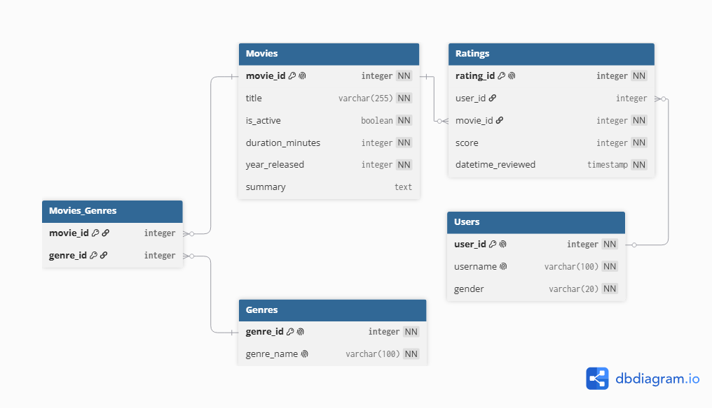
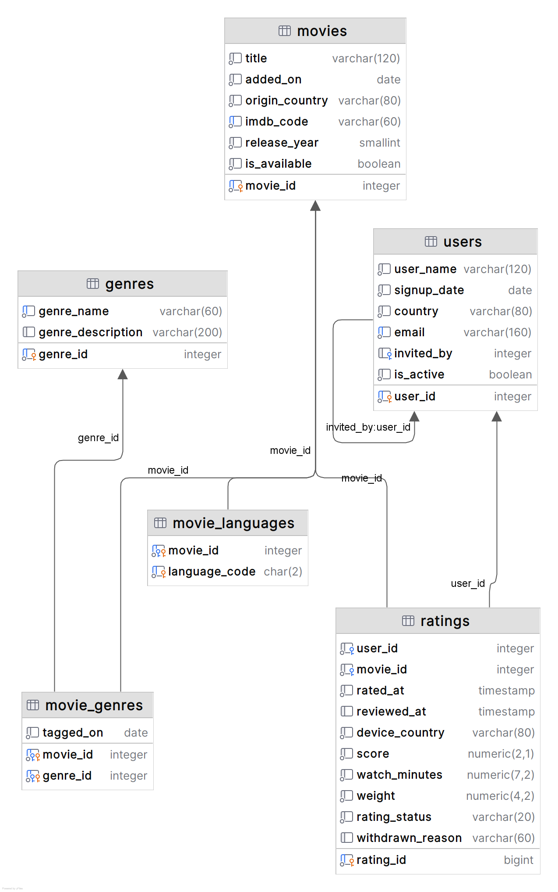

# Movie Rating Database
Theme: Movies

Summary: The purpose of this database is to organize movie and user rating information for analysis purposes. 

## The Domain

### Unit 1-2
The database stores movies, users, ratings, and genres information. Users submit ratings for movies. Each rating records the user, movie, and score data. Movies connect to genres through the junction table movie_genre so that each movie can be associated with multiple genres and each genre can have many movies associated with it. This allows the database to keep the rating and movie data organized. 

The database should be able to answer questions such as which movie has the highest average rating score, how many ratings each movie receives, and how many movies are released each year. This database can also be used to determine whether there is a relationship between a user’s gender and the genres of the movies they rated, and whether longer movies tend to receive higher or lower scores. These questions help analyze movie preferences and understand patterns in movie ratings. 

### Unit 3-6
The database provided and used for units 3-6 stores movies, users, ratings, genres, movie_languages, and movie_genres. The attributes for each table are more detailed, such as movies including data like origin country and IMDB code. Additionally, there is a movie_languages table that stores the languages associated with each movie. The ratings table also includes data like watch minutes, a weight, device country, rating status, and a withdrawal reason (e.g. "Spam detected", "Duplicate rating", "User request", "Policy violation", or no value).

The database should be able to answer questions such as which movies have no ratings, what the rating count and average score is for each movie, the rating count statistics like minimum, maximum, and average, the total number of ratings and spam detected ratings for each movie, and how the platform's spam-related failure rate changes month to month. It can also determine how individual movie ratings can compare with the average rating for that movie. These questions help analyze movie ratings and the spam-detected failure rates.

## Database Overview

### Unit 1-2

#### Entity Relationship Diagram (ERD)

#### Schema

Tables
- users: registered users that are rating the movies
- movies: includes movie information, such as title, release year, and duration in minutes
- genres: includes categories for movie genres, such as comedy, action, etc
- ratings: includes rating information users submit for any movies
- movies_genres: junction table mapping movies to genres (M:N)

Design Decisions
- Created a junction table called movies_genres with a composite primary key to prevent duplicate genres tied to a movie
- Implemented CHECK constraints on attributes like year released, rating score, and gender to ensure only valid data is allowed into the database
- Chose ON DELETE actions such as SET NULL and RESTRICT that best fit the needs and purpose of this database to ensure any essential data that may be used for analysis are not deleted
- Chose the types that fit each attribute such as NUMERIC(3,2) for rating score and varchar(n) with an n that makes sense 
- Added a derived attribute in Movies called display_title which combines the title and year released
- Added a recursive foreign key in movies by adding a foreign key called related_movie_id. This can be used to indicate whether the movie has any related movies, e.g. a prequel or sequel.
- Included a weak entity in Ratings which uses ON DELETE CASCADE and a composite primary key of user_id and movie_id. This also means that a user can only make one rating for a movie.

### Unit 3-6

#### Entity Relationship Diagram (ERD)

* ERD diagram exported from DataGrip

Tables
- users: registered users that submit ratings for movies
- movies: stores movie information, such as title, release year, origin country, IMDB code, and availability status
- genres: stores categories for movie genres (drama, sci-fi, comedy, thriller, documentary) along with their descriptions
- ratings: stores rating information users submit (score, watch minutes, rating status, etc) for any movies
- movie_genres: junction table mapping movies to genres (M:N)
- movie_languages: stores the language code associated for each movie

[DDL here](schema/movies.sql)

## Query Catalog

### Unit 3
| Query | Business question |
|---|---|
| [3.1 #1](queries/unit3/q3_1.sql) | What are the last 10 movies that are available and released after 2015? |
| [3.1 #2](queries/unit3/q3_1.sql) | What are the distinct rating statuses in the ratings table? |
| [3.1 #3a](queries/unit3/q3_1.sql) | Which ratings have a watch duration between 25 to 30 minutes? |
| [3.1 #3b](queries/unit3/q3_1.sql) | Which movie titles contain the text Title_0? |
| [3.1 #4b](queries/unit3/q3_1.sql) | Which ratings have a withdrawal of NULL? |
| [3.1 #5](queries/unit3/q3_1.sql) | What are the ratings when separated into easier to read labels? |
| [3.2 A2](queries/unit3/q3_2.sql) | What ratings have a withdrawal reason other than 'Spam detected'? |
| [3.2 A3](queries/unit3/q3_2.sql) | How many ratings have a withdrawal reason of NULL? |
| [3.2 A4](queries/unit3/q3_2.sql) | How many ratings have a withdrawal reason other than 'Spam detected', including ratings with missing reasons? |
| [3.2 B1](queries/unit3/q3_2.sql) | What happens when an alias is defined in SELECT, then referenced in the WHERE clause? |
| [3.2 B2](queries/unit3/q3_2.sql) | How can the alias problem be fixed if repeated in WHERE? |
| [3.2 B2](queries/unit3/q3_2.sql) | How can a CTE be used to fix the alias problem and convert watch hours to minutes? |
| [3.3 #1](queries/unit3/q3_3.sql) | Using a subquery, what users were involved in their ratings detected as spam? |
| [3.3 #2](queries/unit3/q3_3.sql) | Using a CTE, what users were involved in their ratings detected as spam? |
| [3.3 #3](queries/unit3/q3_3.sql) | Using EXISTS, what users were involved in their ratings detected as spam? |
| [3.3 #4](queries/unit3/q3_3.sql) | Do all 3 methods return identical result sets? |

### Unit 4
| Query | Business question |
|---|---|
| [4.1 #1](queries/unit4/q4_1.sql) | What are the total number, sum, average, minimum, and maximum of rating scores, and how many distinct users submitted ratings? |
| [4.1 #2](queries/unit4/q4_1.sql) | What is the rating count and average score for each movie, sorted by descending rating count? |
| [4.1 #3](queries/unit4/q4_1.sql) | Which movies have at least 15 ratings, and what are their average scores? |
| [4.1 #4](queries/unit4/q4_1.sql) | How does a movie's performance in terms of average score differ by the rating's device country? |
| [4.2 #1](queries/unit4/q4_2.sql) | For each movie, what is the total number of ratings and spam detected ratings? |
| [4.2 #2](queries/unit4/q4_2.sql) | What are the total rating count and spam detected counts by a rating's device country? |
| [4.2 #3](queries/unit4/q4_2.sql) | What is the performance baseline, determined by average rating count and number of spam detected failures, for high volume movies? |

### Unit 5
| Query | Business question |
|---|---|
| [5.1 #1](queries/unit5/q5_1.sql) | Who submitted each movie rating, what was the movie title, and when was it rated? |
| [5.1 #2](queries/unit5/q5_1.sql) | Did Title_02, Title_03, and Title_04 share any common genres? |
| [5.1 #3](queries/unit5/q5_1.sql) | How does the rating count of Title_02, Title_03, and Title_04 compare to the other movies? |
| [5.2 A1](queries/unit5/q5_2.sql) | Which movies have ratings, and which movies have no ratings? |
| [5.2 A2](queries/unit5/q5_2.sql) | Which movies have at least one matching rating record? |
| [5.2 B1](queries/unit5/q5_2.sql) | How can a RIGHT JOIN be used to return all movies, including those without ratings? |
| [5.2 B2](queries/unit5/q5_2.sql) | How do you confirm that the results are the same regardless of using a LEFT JOIN or RIGHT JOIN? |
| [5.2 B3](queries/unit5/q5_2.sql) | Are there any unmatched records in either the movies or ratings table? |
| [5.2 C1](queries/unit5/q5_2.sql) | Using NOT EXISTS, which movies have no ratings? |
| [5.2 C2](queries/unit5/q5_2.sql) | Using EXCEPT, which movies have no ratings? |
| [5.3 A1](queries/unit5/q5_3.sql) | How many movies and genres are saved in the database? |
| [5.3 A2](queries/unit5/q5_3.sql) | How many rows would there be if movies and genres were cross joined? |
| [5.3 B1](queries/unit5/q5_3.sql) | What is the execution plan of query 5.1 #1? |

### Unit 6
| Query | Business question |
|---|---|
| [6.1 #1](queries/unit6/q6_1.sql) | How does each individual movie rating compare with the average rating for that movie? |
| [6.1 #2](queries/unit6/q6_1.sql) | What would the number of ratings leaderboard be when ordered using row number, rank, and dense rank? |
| [6.1 #3](queries/unit6/q6_1.sql) | How do you sort the movie rating counts into 4 bands? |
| [6.2 A](queries/unit6/q6_2.sql) | Do each movie's ratings go up or down over time? |
| [6.2 B](queries/unit6/q6_2.sql) | How is the platform performing over time in terms of ratings? |
| [6.2 C](queries/unit6/q6_2.sql) | What movies have a gap where there were no ratings recorded for more than 30 days? |
| [6.3 A](queries/unit6/q6_3.sql) | What are the top 3 ratings per movie? |
| [6.3 B](queries/unit6/q6_3.sql) | How does the monthly spam-related failure rate change over time? |

## Technical Highlights

There were multiple SQL techniques applied throughout. Examples include:

### Aggregations and GROUP BY
This can be seen in Unit 4's queries. Aggregate functions such as COUNT(), SUM(), and AVG() were used to analyze the movie and ratings data. For example, it helped to calculate the total number of ratings, and the average score. GROUP BY was also useful because it helped to organize the data by movie id or title.

### JOINs
This can be seen in Unit 5's queries. A variation of INNER JOIN, LEFT JOIN, RIGHT JOIN, FULL OUTER JOIN, and CROSS JOIN were used to combine data from different tables. For example, JOIN was used to combine the users, movies, and ratings tables to find out information like who submitted each movie rating, what was the movie title, and when was it rated. It was also shown that using a LEFT JOIN or a RIGHT JOIN can produce the same result if written correctly.

### Window functions
This can be seen in Unit 6's queries. Window functions such as LAG(), LEAD(), AVG() OVER(), and ranking functions (RANK, DENSE_RANK, and ROW_NUMBER) were used to compare records that were able to give more insight compared to just using GROUP BY. For example, a window function can be used to compare each individual movie rating to see if the rating is higher or lower than the movie's average rating because it preserves each individual row while showing additional information. It also helped with calculating running totals and comparing ratings over time. 

## Findings and Recommendations

1. Unit 4: Percentage of movies marked as spam vary across movies

The results show that out of 200, there are 12 spam reviews, which is an overall spam rate of 6%. Title_02 had the highest failure rate at 18.75% (3/16), followed by Title_04 at 16.67% (1/6), and Title_03 at 15.38% (2/13). However, Title_04 only had six ratings, making its failure rate less reliable. I recommend prioritizing Title_02, Title_03, and Title_04 for further investigation.

2. Unit 5: Some movies didn't receive any ratings

The analysis identified Title_14 and Title_15 as movies that have not received any ratings. This could indicate lower engagement or visibility on the platform, meaning it might need to be promoted more. It should also be checked whether these movies are listed properly, and easy for viewers to find.

3. Unit 6: Spam-related failure rates fluctuate over time

The analysis showed that the spam-related failure rate fluctuated throughout 2023 rather than consistently improving or worsening. For example, in January, the failure rate was 9.52% but dropped to 0% in February. However, it increased to 18.18% in March. It continued to fluctuate, since October and November had no failures recorded but increased to 12.5% in December. I recommend that the team continue reviewing the monthly failure rates to identify solutions to improve it.

## Limitations and Future Improvements

### Limitation
One limitation is that some movies have relatively few ratings, which can make their failure rates less reliable. For example, Title_04 had a failure rate of 16.67%, with only six ratings. This means that movies with a small number of spam-related ratings can impact the failure rate percentage, making it difficult to determine whether the movie should be looked into. 

### Future Improvement
The platform should try to collect more rating data over time for each movie in the database. They should consider both the failure rate and total number of ratings when identifying which movies need to be investigated. This would help provide a more accurate comparison and prevent movies with a small sample size from being prioritized if only focusing on their failure rate percentage.

## Video Presentation

[Video Presentation](https://youtu.be/nO56yB2MjfY)

## How to Run

DataGrip is recommended to run these queries in this project:
1. Install PostgreSQL and DataGrip
2. Add a new PostgreSQL data source
- host: localhost
- port: 5432
- user: postgres
- password: the password you set
3. Create a database named ex603_data
4. Load the [movies.sql](schema/movies.sql) file. There should be 6 tables.
5. Open each unit's query file to run any query
